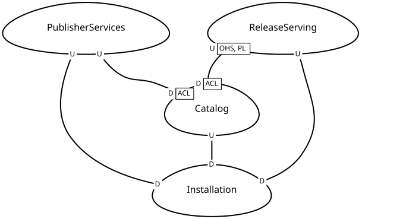
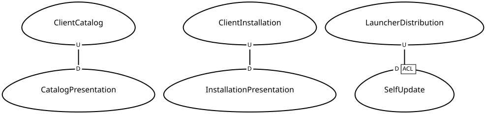
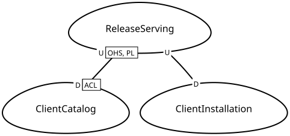

# Context map

[Documentation](docs/README.md) · [Contributing](docs/contributing.md)

Start with a crate, use its map to understand the context relationships, then
follow the directory links into the implementation. Each map focuses on one
crate and includes the neighbouring contexts it integrates with.

| Crate | Start here | What it owns |
| --- | --- | --- |
| [`wg-update-client`](crates/wg-update-client) | [Client map](#wg-update-client) | Game discovery and local installation behavior |
| [`wg-launcher-cli`](crates/wg-launcher-cli) | [CLI map](#wg-launcher-cli) | Terminal presentation and launcher self-update |
| [`wg-update-service`](crates/wg-update-service) | [Service map](#wg-update-service) | Serving prepared game releases |

## wg-update-client



[CML source](docs/context-maps/wg-update-client.cml) · [Crate guide](crates/wg-update-client/README.md) · [Public API entry point](crates/wg-update-client/src/lib.rs)

**Owned here:** Catalog and Installation. **Neighbours:** PublisherServices
(external Wargaming and Lesta services) and ReleaseServing (`wg-update-service`).
The providers are alternatives; the map implies no integration between them.
Catalog resolves a published release; Installation uses that model and downloads
packages directly from the selected provider.

| Map node | Code directory | Responsibilities and guide |
| --- | --- | --- |
| Catalog | [`src/catalog/`](crates/wg-update-client/src/catalog) | Published offerings, selections, and patch planning. [Shared language](crates/wg-update-client/src/catalog/README.md). |
| Installation | [`src/installation/`](crates/wg-update-client/src/installation) | Download, extraction, installed identity, status, updates, and recovery. [Shared language](crates/wg-update-client/src/installation/README.md). |

Within each context, `mod.rs` exposes its entry points. Follow `domain/` for
rules and models, `application/` for workflows, and `infrastructure/` for adapters.
Useful paths for following the map's relationships:

- [`catalog/infrastructure/wgus/`](crates/wg-update-client/src/catalog/infrastructure/wgus): publisher HTTP/XML translation (ACL).
- [`installation/application/resolution.rs`](crates/wg-update-client/src/installation/application/resolution.rs): Installation calls Catalog.
- [`installation/infrastructure/transfer/`](crates/wg-update-client/src/installation/infrastructure/transfer): package downloads from either provider.
- [`installation/application/pipeline/`](crates/wg-update-client/src/installation/application/pipeline): coordinated transfer and extraction.

## wg-launcher-cli



[CML source](docs/context-maps/wg-launcher-cli.cml) · [Crate guide](crates/wg-launcher-cli/README.md) · [Executable entry point](crates/wg-launcher-cli/src/main.rs)

**Owned here:** catalog and installation presentation adapters, plus SelfUpdate.
**Neighbours:** ClientCatalog and ClientInstallation in `wg-update-client`, and
LauncherDistribution (external launcher release hosting).
CatalogPresentation and InstallationPresentation are navigation nodes for CLI
adapters of the library's contexts; they do not introduce additional business
domain boundaries. SelfUpdate owns launcher executable updates independently
of game installation.

| Map node | Code directory | Responsibilities and guide |
| --- | --- | --- |
| CatalogPresentation | [`src/catalog/`](crates/wg-launcher-cli/src/catalog) | Selection arguments, discovery tables, and custom product-file loading. [Guide](crates/wg-launcher-cli/src/catalog/README.md). |
| InstallationPresentation | [`src/installation/`](crates/wg-launcher-cli/src/installation) | Installation arguments, summaries, observers, and progress bars. [Guide](crates/wg-launcher-cli/src/installation/README.md). |
| SelfUpdate | [`src/self_update/`](crates/wg-launcher-cli/src/self_update) | Release checks, package-manager ownership, candidate verification, and executable replacement. [Shared language](crates/wg-launcher-cli/src/self_update/README.md). |
| ClientCatalog | [`wg-update-client/src/catalog/`](crates/wg-update-client/src/catalog) | Library-owned catalog behavior called by the CLI. |
| ClientInstallation | [`wg-update-client/src/installation/`](crates/wg-update-client/src/installation) | Library-owned installation behavior and progress contracts. |

Start at [`src/cli/`](crates/wg-launcher-cli/src/cli) for command parsing and
cross-context dispatch. In catalog and installation, `presentation/commands.rs`
calls the library and coordinates output. Self-update has its own `domain/`,
`application/`, `infrastructure/`, and `presentation/` directories.
Shared terminal formatting lives in [`src/terminal/`](crates/wg-launcher-cli/src/terminal).

## wg-update-service



[CML source](docs/context-maps/wg-update-service.cml) · [Crate guide](crates/wg-update-service/README.md) · [Executable entry point](crates/wg-update-service/src/main.rs) · [Public API entry point](crates/wg-update-service/src/lib.rs)

**Owned here:** ReleaseServing. **Neighbours:** ClientCatalog and
ClientInstallation in `wg-update-client`. The service exposes prepared release
descriptions and package bytes through HTTP and has no Rust dependency on the
client or CLI.

| Map node | Code directory | Responsibilities and guide |
| --- | --- | --- |
| ReleaseServing | [`src/release_serving/`](crates/wg-update-service/src/release_serving) | WGUS-compatible release discovery and package serving. [Shared language](crates/wg-update-service/src/release_serving/README.md). |
| ClientCatalog | [`wg-update-client/src/catalog/`](crates/wg-update-client/src/catalog) | Downstream consumer of release discovery. |
| ClientInstallation | [`wg-update-client/src/installation/`](crates/wg-update-client/src/installation) | Downstream consumer of package downloads. |

Inside `release_serving/`, follow [`domain/`](crates/wg-update-service/src/release_serving/domain)
for URL and template rules, [`application/`](crates/wg-update-service/src/release_serving/application)
for service lifetime and routing, [`infrastructure/`](crates/wg-update-service/src/release_serving/infrastructure)
for HTTP, file access, ranges, and access logs, and
[`presentation/`](crates/wg-update-service/src/release_serving/presentation) for CLI startup.

## Supporting code

[`e2e/`](e2e) is independent black-box test infrastructure, outside the production
context maps. See the [testing guide](docs/testing.md) for scenarios and fixtures.
The full [workspace layout](docs/contributing.md#workspace-layout) also locates
packaging, examples, and supporting files. Networking, archive decoding,
persistence, and terminal helpers remain technical capabilities inside their
owning contexts.

## Reading the patterns

| Label | Meaning in these maps |
| --- | --- |
| U / D | Upstream contract/model provider and downstream consumer. The direction expresses influence, not request order. |
| OHS | Open Host Service: ReleaseServing exposes a reusable discovery interface. |
| PL | Published Language: its WGUS-compatible XML is the integration contract. |
| ACL | Anticorruption Layer: Catalog and SelfUpdate translate external representations into local models. |

These are technical interpretations of the current implementation. They do not
assert team ownership, planning commitments, or Customer/Supplier agreements.
The patterns follow the [DDD Crew context mapping guide](https://github.com/ddd-crew/context-mapping).

## Maintaining the maps

Edit the CML sources under [docs/context-maps](docs/context-maps) when context
boundaries or integration contracts change. Diagram rendering is automated;
discovering boundaries and choosing DDD patterns still requires review.

The [Context maps workflow](.github/workflows/context-maps.yml) validates all
models and renders SVGs only on relevant pushes to `main` or manual runs on
`main`. It does not run on pull requests. After rendering,
`github-actions[bot]` commits only changed SVGs. It also removes diagrams
whose CML model was removed. An unchanged rendering produces no commit.

The commit job uses the built-in `GITHUB_TOKEN` with `contents: write`; no extra
secret is needed. Repository rules must allow that bot to push to `main`.
A concurrent update to `main` can reject the push; rerun the workflow against
the latest `main` in that case. The workflow never force-pushes.

To regenerate locally, install Python 3.12+, Java 17+, and Graphviz, then run:

```console
python3 docs/context-maps/generate.py
```

Set `JAVA_HOME` if Java is not on `PATH`; `dot` must be on `PATH`.
The script downloads the pinned Context Mapper CLI 6.12.0 distribution, verifies
its SHA-256, and validates every model before replacing generated SVGs.
It fixes Context Mapper's randomized context orientations in the generated
Graphviz source before rendering, so identical models produce identical SVGs
with the same toolchain.
Tools and intermediate files live in a temporary directory outside the checkout.
Use the workflow's Ubuntu/Java/Graphviz environment for consistent layout;
different Graphviz versions can produce different SVG bytes.

The [Context Mapper CLI](https://github.com/ContextMapper/context-mapper-cli)
and [context map generator](https://contextmapper.org/docs/context-map-generator/)
provide model validation and diagram generation.
