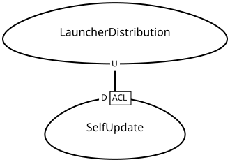

# Context map

[Documentation](docs/README.md) · [Contributing](docs/contributing.md)

These two views cover the three production crates. Contexts describe domain
responsibilities rather than Cargo packages or individual layers. The E2E
package is test infrastructure and is outside these maps.

| Crate | Responsibilities represented here |
| --- | --- |
| `wg-update-client` | Catalog and Installation |
| `wg-launcher-cli` | Catalog/Installation presentation adapters and SelfUpdate |
| `wg-update-service` | ReleaseServing |

The CLI's game commands call the client library. They do not introduce separate
catalog or installation domain models. Terminal helpers, networking, archive
decoding, and persistence are implementation details inside their owning contexts.

## Game assets


[CML source](docs/context-maps/game-assets.cml)

Catalog translates publisher discovery responses into release and selection
models. Installation consumes those models and obtains package bytes directly
from the selected service. ReleaseServing is our independent WGUS-compatible
provider; PublisherServices groups external Wargaming and Lesta systems. They
are alternative providers, with no integration between the two providers implied.

See the [Catalog](crates/wg-update-client/src/catalog/README.md),
[Installation](crates/wg-update-client/src/installation/README.md), and
[Release serving](crates/wg-update-service/src/release_serving/README.md) guides.

## Launcher updates



[CML source](docs/context-maps/launcher-updates.cml)

SelfUpdate consumes launcher release manifests, archives, and checksums from
release hosting. It maps that external contract into launcher release and
ownership decisions. Managed installations receive their package-manager
instructions; direct installations can replace the verified executable.
This is independent of game asset updates.

See the [Self-update](crates/wg-launcher-cli/src/self_update/README.md) guide.

## Reading the patterns

| Label | Meaning in these maps |
| --- | --- |
| U / D | Upstream contract/model provider and downstream consumer. The direction expresses influence, not request order. |
| OHS | Open Host Service: ReleaseServing exposes a reusable discovery interface. |
| PL | Published Language: its WGUS-compatible XML is the integration contract. |
| ACL | Anticorruption Layer: Catalog and SelfUpdate translate external representations into local models. |

These are technical interpretations of the current implementation. They do not
assert team ownership, planning commitments, or Customer/Supplier agreements.
The patterns follow the [DDD Crew context mapping guide](https://github.com/ddd-crew/context-mapping).

## Maintaining the maps

Edit the CML sources under [docs/context-maps](docs/context-maps) when context
boundaries or integration contracts change. Diagram rendering is automated;
discovering boundaries and choosing DDD patterns still requires review.

The [Context maps workflow](.github/workflows/context-maps.yml) validates all
models and renders SVGs only on relevant pushes to `main` or manual runs on
`main`. It does not run on pull requests. After rendering,
`github-actions[bot]` commits only changed SVGs. It also removes diagrams
whose CML model was removed. An unchanged rendering produces no commit.

The commit job uses the built-in `GITHUB_TOKEN` with `contents: write`; no extra
secret is needed. Repository rules must allow that bot to push to `main`.
A concurrent update to `main` can reject the push; rerun the workflow against
the latest `main` in that case. The workflow never force-pushes.

To regenerate locally, install Python 3.12+, Java 17+, and Graphviz, then run:

```console
python3 docs/context-maps/generate.py
```

Set `JAVA_HOME` if Java is not on `PATH`; `dot` must be on `PATH`.
The script downloads the pinned Context Mapper CLI 6.12.0 distribution, verifies
its SHA-256, and validates every model before replacing generated SVGs.
It fixes Context Mapper's randomized context orientations in the generated
Graphviz source before rendering, so identical models produce identical SVGs
with the same toolchain.
Tools and intermediate files live in a temporary directory outside the checkout.
Use the workflow's Ubuntu/Java/Graphviz environment for consistent layout;
different Graphviz versions can produce different SVG bytes.

The [Context Mapper CLI](https://github.com/ContextMapper/context-mapper-cli)
and [context map generator](https://contextmapper.org/docs/context-map-generator/)
provide model validation and diagram generation.
