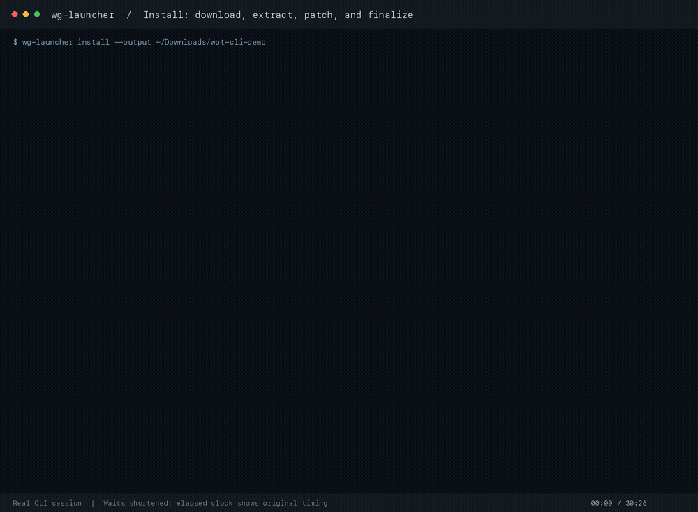

# wg-launcher

Download, install, and update Wargaming game assets from your terminal or Rust app.
Works with Wargaming, Lesta, and your own WGUS-compatible update services.

[Documentation](docs/README.md) · [CLI guide](crates/wg-launcher-cli/README.md) · [Rust guide](crates/wg-update-client/README.md) · [API reference](https://docs.rs/wg-update-client/latest/wg_update_client/) · [Releases](https://github.com/gabrielhamel/wg-launcher/releases)

## Install the CLI

Install a prebuilt executable for your platform. Rust and Cargo are not required.

### Homebrew (macOS and Linux x64)

```sh
brew install gabrielhamel/tap/wg-launcher
```

Upgrade Homebrew installations with `brew update`, then
`brew upgrade gabrielhamel/tap/wg-launcher`.

### Windows

The WinGet package has been [submitted to Microsoft](https://github.com/microsoft/winget-pkgs/pull/468869).
After Microsoft approves and indexes it, install with:

```powershell
winget install --id GabrielHamel.WgLauncher --exact --source winget
```

Upgrade WinGet installations with:

```powershell
winget upgrade --id GabrielHamel.WgLauncher --exact --source winget
```

You can install Windows x64 immediately with this PowerShell installer:

```powershell
powershell -ExecutionPolicy Bypass -c "irm https://github.com/gabrielhamel/wg-launcher/releases/latest/download/wg-launcher-cli-installer.ps1 | iex"
```

### macOS

Run this in Terminal. The installer selects Apple Silicon or Intel automatically:

```sh
curl --proto '=https' --tlsv1.2 -LsSf https://github.com/gabrielhamel/wg-launcher/releases/latest/download/wg-launcher-cli-installer.sh | sh
```

### Linux

Debian 12+ and Ubuntu 22.04+ users on x64 can use the
[signed apt repository](crates/wg-launcher-cli/README.md#apt-debian-and-ubuntu).
For a standalone Linux x64 installation, run:

```sh
curl --proto '=https' --tlsv1.2 -LsSf https://github.com/gabrielhamel/wg-launcher/releases/latest/download/wg-launcher-cli-installer.sh | sh
```

Follow the installer's instructions to add `wg-launcher` to your `PATH`, then
open a new terminal and check the installation:

```console
wg-launcher --version
```

For archive downloads or building from source, see the
[installation guide](crates/wg-launcher-cli/README.md#install-the-cli).
The CLI checks for newer stable releases at startup and warns when one is
available. `wg-launcher --version` shows the installed and latest versions.
Upgrade a direct installation with:

```console
wg-launcher self-update
```

Package-manager installations must be upgraded through their package manager.
See [upgrade instructions](crates/wg-launcher-cli/README.md#upgrade-the-cli)
for details and installer alternatives. `wg-launcher update` updates game assets only.

## Try the CLI

Preview the available builds before downloading game assets:

```console
wg-launcher list --region eu
wg-launcher inspect --game wot --region eu
wg-launcher inspect --game wows --region ww
```

Ready to install? Choose a directory, then check or update it whenever you need:

```console
wg-launcher install --game wot --region eu --output ./world-of-tanks
wg-launcher status --path ./world-of-tanks
wg-launcher update --path ./world-of-tanks
```

`inspect`, `download`, and `install` require an explicit game. After selecting
`wot`, its region defaults to EU. The publisher's default client variant is used;
if none is usable, the smallest installable variant is selected.
The built-in catalog also includes World of Warships, World of
Warplanes, and World of Tanks Blitz; `list` shows every game by default.
The launcher runs on Windows, Linux, and macOS; supported game payloads target
Windows/x64. It manages game assets, without player login or launching the game.

<details>
<summary>See an installation in action</summary>



</details>

## Use it from Rust

Add the client and Tokio to your application:

```toml
[dependencies]
wg-update-client = "1"
tokio = { version = "1", features = ["macros", "rt-multi-thread"] }
```

Preview a build without downloading game packages:

```rust,no_run
use wg_update_client::{BuildSelection, InspectOptions, inspect};

#[tokio::main]
async fn main() -> wg_update_client::Result<()> {
    let build = inspect(InspectOptions {
        selection: BuildSelection {
            game: Some("wot".into()),
            ..Default::default()
        },
    })
    .await?;
    println!(
        "{} — {} bytes to download",
        build.version,
        build.download_size()
    );
    Ok(())
}
```

The [Rust guide](crates/wg-update-client/README.md) has complete examples for
installation, updates, progress events, offline extraction, and custom catalogs.

## What would you like to do?

| Task | Start here |
| --- | --- |
| Pick a game, region, client variant, or language | [CLI walkthrough](crates/wg-launcher-cli/README.md#choose-your-build) |
| Download now and install offline | [Staged installation](crates/wg-launcher-cli/README.md#download-now-install-later) |
| Use a custom service or region such as KR | [Custom catalogs](docs/catalogs.md) |
| Host WGUS-compatible release files | [Update service](docs/update-service.md) |
| Integrate installation into an app | [Rust examples](crates/wg-update-client/README.md) |
| Resume a download or solve an error | [Troubleshooting](docs/troubleshooting.md) |
| Build from source or contribute | [Contributor guide](docs/contributing.md) |

[Browse all documentation →](docs/README.md)
