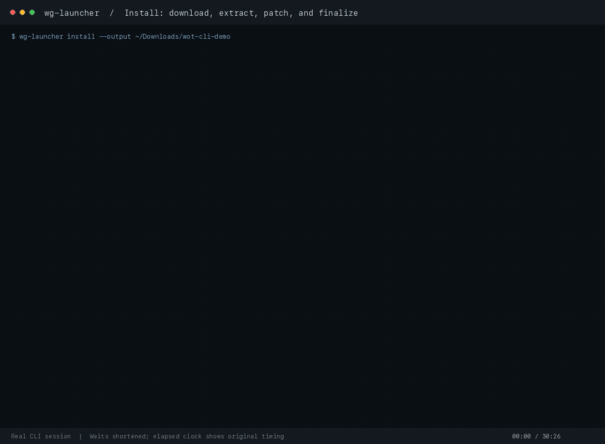

# wg-launcher CLI

Discover, download, install, and update World of Tanks assets from your terminal.
Supports Wargaming regions, Common Test, and Lesta RU.



The CLI runs on Windows, Linux, and macOS. The supported game payload is
Windows/x64. Player authentication and launching the game are outside its
current scope.

## Package boundary

Product decision: `wg-launcher-cli` owns terminal argument parsing and progress
rendering and depends on the separate `wg-launcher` library. Its installed
executable remains `wg-launcher`, so command names and behavior stay the same.
Library consumers choose progress independently; this CLI opts in to typed
library events and renders them for terminal users.

The workspace root is no longer an installable package. From a checkout, use
the explicit package path below, or `cargo run -p wg-launcher-cli -- --help`.

## Install the CLI

Build and install from source with Rust and Cargo:

```console
git clone https://github.com/gabrielhamel/wg-launcher.git
cd wg-launcher
cargo install --path crates/wg-launcher-cli --locked
```

No external archive or patching utilities are required.

## Quick start

Commands that select a new build (`inspect`, `download`, and `install`) default
to EU/SD. Customize the build with `--region` and `--client-type`, or use
`--language` to override the region's default language.

Inspect a build, install it into a directory of your choice, then check its status:

```console
wg-launcher inspect
wg-launcher install --output ./world-of-tanks
wg-launcher status --path ./world-of-tanks
```

Run `wg-launcher update --path ./world-of-tanks` when a newer build is available.

## Commands

| Command | Purpose |
| --- | --- |
| `list` | Compare available builds, sizes, and languages. |
| `inspect` | Show a build's components and patch chain without changing files. |
| `download` | Save packages for a staged or offline installation. |
| `extract` | Install a complete local package cache. |
| `install` | Download and install in one pipeline. |
| `status` | Compare the installed version with the latest published build. |
| `update` | Update an existing installation in place. |

Use `wg-launcher <command> --help` for all options.

### Discover and inspect builds

```console
wg-launcher list
wg-launcher list --region ru
wg-launcher inspect --region eu --client-type hd --language FR
```

`list` queries all regions by default: `eu`, `na`, `asia`, `cn`, `ru`, and `ct`.
Its table shows versions, payload targets, compressed sizes, and languages;
`*` marks each region's default language.

`inspect` shows the selected build and each patch's part,
source version, target version, package count, and compressed size.

### Install a game build

```console
wg-launcher install
wg-launcher install --region eu --client-type hd --language FR --output ./world-of-tanks
```

Without `--output`, the directory name includes the region, channel, initial
version, payload platform, architecture, client type, and language. Updates keep
that original directory name.

Downloading overlaps extraction, and packages are released after their patch
has been extracted successfully. `--concurrency` controls simultaneous package
downloads and defaults to `3`.

### Download and extract separately

```console
wg-launcher download --output ./world-of-tanks
wg-launcher extract ./world-of-tanks
```

`download` keeps packages and a pinned manifest in the destination's `.wg-launcher/.download`
directory. You can move the whole folder to another machine before extracting.
`extract` reads that local manifest without querying the catalog. Its optional
directory argument defaults to the current directory.

To stage individual components, use the part names shown by `inspect`:

```console
wg-launcher download --output ./world-of-tanks --part client --part locale
```

Without `--part`, every required package is downloaded. Extraction requires the
complete package set, so rerun `download` without a filter before extracting a
partially downloaded build.

### Check and apply updates

From the game directory:

```console
wg-launcher status
wg-launcher update
```

Or specify its location:

```console
wg-launcher status --path ./world-of-tanks
wg-launcher update --path ./world-of-tanks
```

Both commands use the installation's recorded region, client type, and language.
Updates follow the publisher's installation chain and may download more than
only the changed components.

## Resume or move an installation

Retry an interrupted command with the same destination. Complete packages are
reused, and partial downloads resume when the server supports it. Packages
already released after extraction may need to be downloaded again during a
retry.

Successful installation or extraction cleans up `.wg-launcher/.download` and `.wg-launcher/.installing`.
Keep the `.wg-launcher` folder inside the game directory: it records the installed
build for `status` and `update`. Moving the whole folder preserves its identity
and any remaining download cache. A per-installation lock prevents concurrent
changes to the same directory.

All files created by the CLI or library for an installation, including future
metadata, logs, caches, locks, temporary outputs, and replacement backups, belong
under `<installation>/.wg-launcher/`. Game payload files remain in the game tree.
The `.wg-launcher` directory is reserved and archive entries cannot write into it.
Successful cleanup removes only its cache and temporary work; identity and lock
remain so the installation stays portable and usable by `status` and `update`.

## Rust library

The same workflows are available through the `wg_launcher` crate, with typed
options, reports, and progress events for applications embedding the launcher.
See the [library guide](../wg-launcher/README.md) for API examples, event handling, and
installation internals. Generate the full API reference locally with
`cargo doc -p wg-launcher --lib --no-deps --locked --open`; its landing page includes checked
examples for embedding the library.
