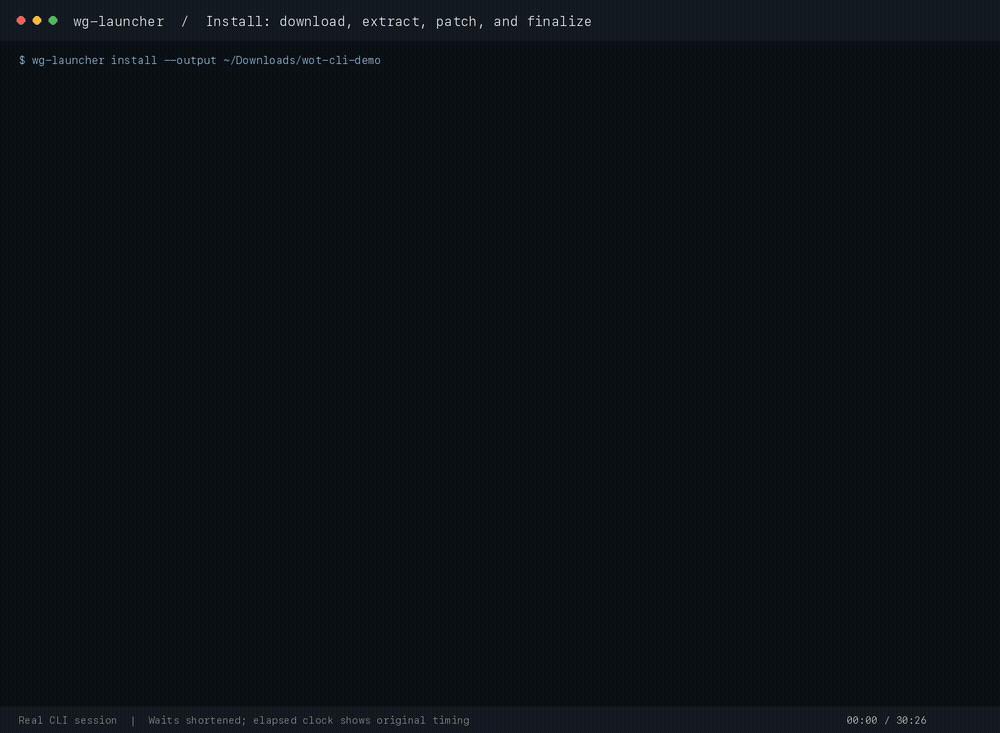

# wg-launcher CLI

Install and update game assets with a few terminal commands.
The CLI works on Windows, Linux, and macOS; supported game payloads target
Windows/x64. Player login and launching the game are outside its scope.

[Documentation home](../../docs/README.md) · [Rust guide](../wg-update-client/README.md) · [Custom catalogs](../../docs/catalogs.md) · [Help with errors](../../docs/troubleshooting.md)

**On this page:** [Install the CLI](#install-the-cli) · [Upgrade the CLI](#upgrade-the-cli) · [Choose a build](#choose-your-build) · [Install the game](#install-the-game) · [Update](#check-and-apply-updates) · [Offline installation](#download-now-install-later) · [Commands](#command-overview)

## Install the CLI

Install with Homebrew, apt, or WinGet, or expand the manual installation
section below to download the latest release. Rust and Cargo are not required. The CLI is distributed through GitHub Releases;
only the `wg-update-client` Rust library is published to crates.io.

### Homebrew

On macOS (Apple Silicon or Intel) and Linux x64:

```sh
brew install gabrielhamel/tap/wg-launcher
```

The [Homebrew tap](https://github.com/gabrielhamel/homebrew-tap) downloads the
published binary for your platform and verifies its checksum.

To upgrade:

```sh
brew update
brew upgrade gabrielhamel/tap/wg-launcher
```

If you previously used the shell installer, check `which -a wg-launcher` and
remove the older standalone copy from your `PATH` so the Homebrew executable is
used. Homebrew owns this installation; `wg-launcher self-update` directs you to
`brew upgrade` and does not replace the managed executable.

### apt (Debian and Ubuntu)

For Debian 12+ and Ubuntu 22.04+ on x64, add the signed repository once:

```sh
sudo install -d -m 0755 /etc/apt/keyrings
curl -fsSL https://gabrielhamel.github.io/wg-launcher/apt/wg-launcher.asc | sudo tee /etc/apt/keyrings/wg-launcher.asc > /dev/null
echo "deb [arch=amd64 signed-by=/etc/apt/keyrings/wg-launcher.asc] https://gabrielhamel.github.io/wg-launcher/apt stable main" | sudo tee /etc/apt/sources.list.d/wg-launcher.list > /dev/null
sudo apt update
sudo apt install wg-launcher
```

To upgrade:

```sh
sudo apt update
sudo apt install --only-upgrade wg-launcher
```

APT verifies the signed repository and package checksums. This package disables
built-in self-update; use apt to manage its executable.

### WinGet (Windows x64)

The WinGet package has been [submitted to Microsoft](https://github.com/microsoft/winget-pkgs/pull/468869).
After Microsoft approves and indexes it, install with:

```powershell
winget install --id GabrielHamel.WgLauncher --exact --source winget
```

Upgrade WinGet installations with:

```powershell
winget upgrade --id GabrielHamel.WgLauncher --exact --source winget
```

Until Microsoft publishes the package, use the manual Windows installer below.

### Manual installation

<details>
<summary>Install with PowerShell, curl, an archive, or Rust and Cargo</summary>

#### Windows x64

Run this in PowerShell:

```powershell
powershell -ExecutionPolicy Bypass -c "irm https://github.com/gabrielhamel/wg-launcher/releases/latest/download/wg-launcher-cli-installer.ps1 | iex"
```

#### macOS

Run this in Terminal. The installer selects Apple Silicon or Intel automatically:

```sh
curl --proto '=https' --tlsv1.2 -LsSf https://github.com/gabrielhamel/wg-launcher/releases/latest/download/wg-launcher-cli-installer.sh | sh
```

#### Linux

For Linux x64, run:

```sh
curl --proto '=https' --tlsv1.2 -LsSf https://github.com/gabrielhamel/wg-launcher/releases/latest/download/wg-launcher-cli-installer.sh | sh
```

#### Check the installation

The installers place `wg-launcher` in `$CARGO_HOME/bin` when `CARGO_HOME` is set.
Otherwise, they use `~/.cargo/bin` on macOS and Linux or
`%USERPROFILE%\.cargo\bin` on Windows. Rust and Cargo do not need to be installed.

Follow the installer's instructions to refresh your `PATH`, then open a new
terminal and run:

```console
wg-launcher --version
wg-launcher --help
```

#### Download an archive manually

Choose the archive matching the computer running the launcher:

| Platform | Download |
| --- | --- |
| Windows x64 | [ZIP](https://github.com/gabrielhamel/wg-launcher/releases/latest/download/wg-launcher-cli-x86_64-pc-windows-msvc.zip) |
| macOS Apple Silicon | [tar.gz](https://github.com/gabrielhamel/wg-launcher/releases/latest/download/wg-launcher-cli-aarch64-apple-darwin.tar.gz) |
| macOS Intel | [tar.gz](https://github.com/gabrielhamel/wg-launcher/releases/latest/download/wg-launcher-cli-x86_64-apple-darwin.tar.gz) |
| Linux x64 | [tar.gz](https://github.com/gabrielhamel/wg-launcher/releases/latest/download/wg-launcher-cli-x86_64-unknown-linux-gnu.tar.gz) |

Extract the archive and put `wg-launcher.exe` (Windows) or `wg-launcher`
(macOS/Linux) in a directory on your `PATH`. Each archive has a matching
`.sha256` file on the [release page](https://github.com/gabrielhamel/wg-launcher/releases/latest).
The launcher's host platform is independent of the downloaded game payload,
which currently targets Windows/x64.

#### Build from source with Rust and Cargo

Download the source code from the [latest release](https://github.com/gabrielhamel/wg-launcher/releases/latest),
extract it, and run this from the extracted directory:

```console
cargo install --path crates/wg-launcher-cli --locked
```

For a local checkout, follow the
[source installation guide](../../docs/contributing.md#build-from-source).

</details>

### Upgrade the CLI

Before running a command, the CLI checks the latest stable release and prints a
warning if a newer CLI is available. This check takes at most two seconds;
network failures never prevent game commands from running. No update is installed
automatically.

For an installer, archive, or source installation, run:

```console
wg-launcher self-update
```

The updater downloads the archive for your platform, verifies its SHA-256
checksum, and checks that the new executable runs and reports the expected
version before replacing the current executable. You need write access to the
CLI's directory. Temporary update files are cleaned after success or failure.
Game files and installed game state are not changed.

`wg-launcher --version` shows both the installed and latest stable CLI versions.
If the latest release cannot be checked, it shows `latest: unavailable` and
still exits successfully.

For installations managed by Homebrew, APT, WinGet, Scoop, Nix, or a package manager
marked by the distributor, the CLI reports **Self-update not supported** and
explains how to use that manager to update it. `self-update` refuses to replace
a managed executable. Homebrew and apt are available through the repositories
above. WinGet submissions pass through Microsoft's validation and review before
appearing in its community source.

To skip startup checks for offline use or scripts, set the environment variable
`WG_LAUNCHER_NO_UPDATE_CHECK=1`. Explicit `self-update` still checks for a release.

<details>
<summary>Upgrade by rerunning the installer instead</summary>

The installers also download the latest release and replace the CLI executable.

**Windows — PowerShell:**

```powershell
powershell -ExecutionPolicy Bypass -c "irm https://github.com/gabrielhamel/wg-launcher/releases/latest/download/wg-launcher-cli-installer.ps1 | iex"
```

**macOS and Linux:**

```sh
curl --proto '=https' --tlsv1.2 -LsSf https://github.com/gabrielhamel/wg-launcher/releases/latest/download/wg-launcher-cli-installer.sh | sh
```

Check the installed version afterwards:

```console
wg-launcher --version
```

</details>

You can also [download the latest archive](#download-an-archive-manually) and
replace the executable manually, or rebuild from the latest release source.
`wg-launcher update` updates game assets only.
No additional archive or patching utilities are required to manage game assets.

## Choose your build

First, compare builds. Then inspect a game and region before downloading:

```console
wg-launcher list --region eu
wg-launcher inspect --game wot --region eu
wg-launcher inspect --game wows --region ww
```

`list` shows versions, download sizes, and languages. A `*` marks the default
language. `inspect` shows the selected components and patch sizes without changing
files or downloading game packages.

<details>
<summary>Show HD, language, and region examples</summary>

Choose HD with French assets:

```console
wg-launcher inspect --game wot --region eu --client-type hd --language FR
```

Compare Lesta RU builds:

```console
wg-launcher list --region ru
```

Query every built-in region:

```console
wg-launcher list
```

`list` queries every built-in game and region unless `--game` or `--region`
filters it. Built-in game names are `wot`, `wows`, `wowp`, and `wotb`.
World of Warships, World of Warplanes, and World of Tanks Blitz use the `ww`
catalog region. World of Tanks also provides `eu`, `na`, `asia`, `cn`, `ct`,
`ru`, and `pt-ru`. Custom labels work with a
[custom catalog](../../docs/catalogs.md).

</details>

## Install the game

Choose a destination and start the download and installation:

```console
wg-launcher install --game wot --region eu --output ./world-of-tanks
```

The command performs the operation directly and shows progress. `--game` is
required. With `--game wot`, the region defaults to EU. When `--client-type` is
omitted, the publisher's valid default is used. If no usable default is advertised,
the launcher resolves the available variants and selects the smallest compressed
installation. An explicit `--client-type` always takes precedence.

<details>
<summary>Customize the installation</summary>

Install HD with French assets:

```console
wg-launcher install --game wot --region eu --client-type hd --language FR --output ./world-of-tanks
```

Install another game using its published default client variant:

```console
wg-launcher install --game wowp --region ww --output ./world-of-warplanes
```

Limit simultaneous package downloads:

```console
wg-launcher install --game wot --region eu --output ./world-of-tanks --concurrency 2
```

Download concurrency defaults to `3`. Omitting `--output` creates an automatically
named directory containing the game, region, channel, initial version, payload target,
client type, and language. Updates keep that directory name.

</details>

<details>
<summary>Watch an installation</summary>



</details>

## Check and apply updates

Check the installed and available versions:

```console
wg-launcher status --path ./world-of-tanks
```

Status highlights an available update and the latest version in green, with the
installed version in yellow. It also shows an approximate compressed update size
based on the applicable component patches. Cached packages may reduce the actual
download. Redirected output remains plain text.

Apply an update when one is available:

```console
wg-launcher update --path ./world-of-tanks
```

Both commands use the saved product, region, client type, and language. You do not
need to supply the build options or a custom catalog again. Updates request patches
from each saved component version and skip unchanged components. A component needs
a full download only when it is new or the publisher no longer provides an
applicable delta chain. Interrupted updates reuse their pinned chain and completed
patch checkpoints.

The current state format requires component versions. Older installations and
pinned manifests are not migrated; create a fresh installation to use this format.

<details>
<summary>Run from inside the game directory</summary>

```console
cd world-of-tanks
wg-launcher status
wg-launcher update
```

`status` and `update` use the current directory when `--path` is omitted.

</details>

## Download now, install later

Save the packages first, then extract them locally:

```console
wg-launcher download --game wot --region eu --output ./world-of-tanks
wg-launcher extract ./world-of-tanks
```

You can move the whole folder to another machine between these steps. Extraction
uses the downloaded manifest and works without contacting the update service.
Running `wg-launcher extract` inside the destination selects the current directory.

<details>
<summary>Download selected components first</summary>

Use the component names shown by `inspect`:

```console
wg-launcher download --game wot --region eu --output ./world-of-tanks --part client --part locale
```

Extraction needs the complete package set. Download everything still needed with
the same selection and destination, then extract:

```console
wg-launcher download --game wot --region eu --output ./world-of-tanks
wg-launcher extract ./world-of-tanks
```

</details>

## Use your own update service

Point the command at a JSON product array and select a game and region:

```console
wg-launcher list --product products.json
wg-launcher install --product products.json --game local --region KR --output ./game-kr
```

The [custom catalog guide](../../docs/catalogs.md) includes a two-region example,
field explanations, and matching Rust code. Game and region matching ignore case.
Listing defaults to every configured selection. Build commands require `--game`;
the built-in region defaults to `eu` for WoT and `ww` for the other games.

## Resume or move a game

Retry an interrupted command with the same destination and selection. Complete
packages are reused, and partial files resume when the service supports ranges.
Some successfully extracted packages may need to be downloaded again on a retry.

Keep `.wg-launcher` inside the game folder when moving it. That directory contains
the saved selection and any unfinished download. Successful installation clears
its package cache and temporary work while keeping the installed identity.

If something fails, use the [troubleshooting guide](../../docs/troubleshooting.md).

## Command overview

| Command | Use it to… | Files changed? |
| --- | --- | --- |
| `list` | Compare builds, sizes, and languages | No |
| `inspect` | Preview one build and its components | No |
| `install` | Download and install together | Yes |
| `status` | Compare the installed and available versions | No |
| `update` | Update an installation in place | Yes |
| `download` | Save packages for later installation | Yes |
| `extract` | Install from a complete local cache | Yes |
| `self-update` | Upgrade the CLI executable | CLI executable only |

Use `wg-launcher <command> --help` to explore a command's options.

**Next:** [Custom catalogs](../../docs/catalogs.md) · [Troubleshooting](../../docs/troubleshooting.md) · [Rust examples](../wg-update-client/README.md)
